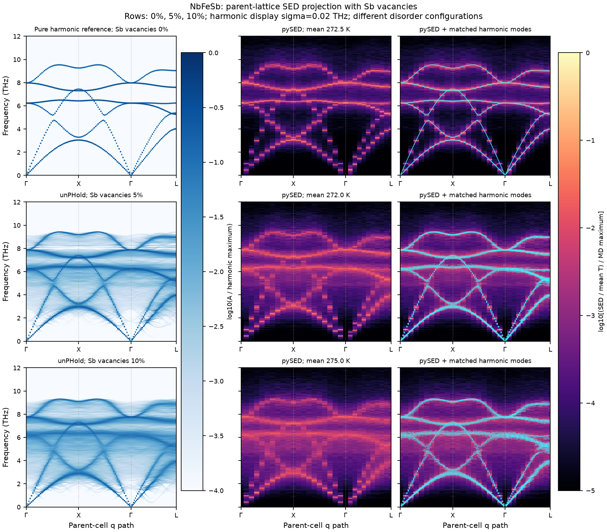

# Application illustration: Sb vacancies in NbFeSb

Rows show 0%, 5%, and 10% vacancies on the **Sb sublattice** of NbFeSb. Columns
show (left) a static harmonic parent-cell spectral function, (middle) the MD/pySED
result near 273 K, and (right) the MD result with corresponding harmonic modes
overlaid in cyan. For the pure crystal, the harmonic result is the nine-branch
Phonopy reference; no defect unfolding is needed. For the vacancy structures,
unPHold projects the defect-periodic-cell eigenvectors onto the complete parent.

The common NEP force model was evaluated through a GPUMD-4.6-compatible calorine
CPUNEP interface. Phonopy constructed second-order force constants from positive
and negative 0.01 Angstrom displacements. Disorder cells contain 5x5x4 parent
primitive cells, with a further 2x2x2 force-calculation supercell. The pure
reference uses a three-atom primitive cell and a 10x10x8 force supercell. No NAC
is applied. The pure reference and any unbroadened pure nine-branch plot share
the same force constants; they are not independent algorithms or validations.

MD uses 20x20x20 parent cells, 10 ps NVT followed by 100 ps fixed-cell NVE, a
1 fs timestep, and a 5 fs dump interval. The spectra have 0.01 THz frequency
spacing. Actual average temperatures and model provenance are recorded in the
[figure metadata](figures/parent_projection_comparison.json). The selected cases
showed no change in nearest parent-site identity in the original sampled-frame
checks; this is not a proof of complete dynamical or sampling convergence.

The harmonic Gaussian width is **sigma=0.02 THz**, used only for display. Cyan
markers show modes with unfolding weight at least 0.02 (a separate, dimensionless
threshold), with marker area proportional to the square root of the weight.
The two spectral definitions have separate logarithmic color normalizations;
MD intensities are divided by each trajectory's actual mean temperature before
the common MD color scaling. Absolute brightness is not directly comparable
between the harmonic and MD columns.

The two methods use different cell sizes and specific random vacancy patterns.
This figure illustrates correspondence of dominant frequency bands and spectral
weight redistribution. It does not establish quantitative agreement of line
widths, validate phonon lifetimes, or substitute for a same-configuration harmonic
equivalence test. The small analytic CLI example and numerical regression tests
provide the reproducible algorithm checks; this image is supplementary evidence.

No NEP weights, production trajectories, or large force-constant files are included
with this illustration. The compact metadata is sufficient to identify how the
display was constructed, but is not a replacement for the original MD inputs.
