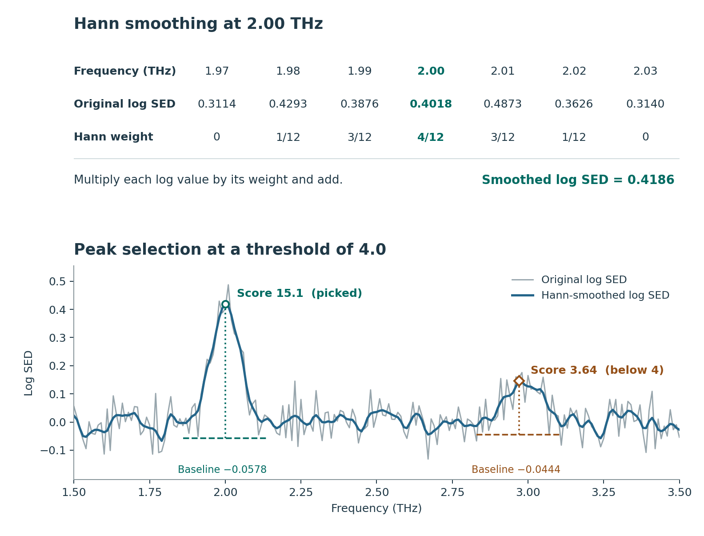

peak_min_significance
~~~~~~~~~~~~~~~~~~~~~

**Syntax**

.. code-block:: text

   peak_min_significance = 4.0

**Meaning**
   Sets how clearly a peak must stand out from nearby noise to be picked.
   If pySED misses a weak peak, lower ``peak_min_significance`` slightly.
   Raise it if small ripples are picked as peaks.

**Default**
   ``4.0``.

**How peaks are picked**

1. **Smooth the spectrum.** pySED takes the natural logarithm of the SED
   and slides a seven-point Hann window along the frequency axis. At each
   step, the smoothed value at the center is the weighted average of the
   seven log values, with weights ``[0, 1, 3, 4, 3, 1, 0] / 12`` from left
   to right. This reduces small ripples when locating peaks. pySED then
   fits each peak to the original SED.
2. **Find the baseline for each peak.** Starting at the peak on the smoothed
   curve, look left and right as far as a higher peak or the edge of the
   spectrum. Find the lowest point on each side. The higher of those two
   levels is the baseline. The peak top minus this baseline is its *prominence*.
3. **Compare the rise with the noise.** pySED uses up to 31 nearby frequency
   points to estimate local noise from the differences between the original
   and smoothed log spectra. A peak can be narrower or wider than this window.
   Divide the prominence by the noise estimate. A peak is picked when its
   score reaches or exceeds your setting.

   In this synthetic spectrum, the top panel shows one step of Hann smoothing
   at 2.00 THz. Below, each dotted line shows how far the smoothed peak rises
   above its dashed baseline.

.. list-table:: Scores for the two peaks in the figure (rounded)
   :header-rows: 1

   * - Peak
     - Smoothed top
     - Baseline
     - Prominence
     - Local noise
     - Score
   * - Near 2 THz
     - 0.4186
     - -0.0578
     - 0.4764
     - 0.0316
     - **15.1**
   * - Near 3 THz
     - 0.1456
     - -0.0444
     - 0.1900
     - 0.0522
     - **3.64**

For the 2 THz peak, the left and right minima are -0.0670 and -0.0578, so
the baseline is -0.0578.

The nearby differences have a median absolute
deviation of 0.0213, giving a noise estimate of
:math:`1.4826 \times 0.0213 \approx 0.0316`. The score is therefore
:math:`[0.4186 - (-0.0578)] / 0.0316 \approx 15.1`.

With the default ``4.0``, only this peak is picked. At ``3.0``, both are picked.

:doc:`Back to Parameter Index <../input_parameters>`

Related parameters
------------------

- :doc:`initial_guess_hwhm <initial_guess_hwhm>`
- :doc:`peak_max_hwhm <peak_max_hwhm>`
- :doc:`lorentz_fit_freq_min <lorentz_fit_freq_min>`
- :doc:`lorentz_fit_freq_max <lorentz_fit_freq_max>`
