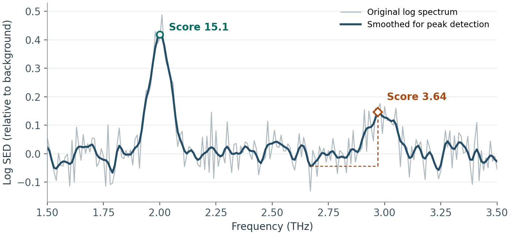

peak_min_significance
~~~~~~~~~~~~~~~~~~~~~

**Syntax**

.. code-block:: text

   peak_min_significance = 4.0

**Meaning**
   Sets how clearly a peak must stand out from nearby noise to be picked.
   Start with ``4.0``. Lower it if you miss a visible peak, or raise it if
   small ripples are picked as peaks.

**Default**
   ``4.0``.

**How peaks are picked**
   On a smoothed log spectrum, pySED measures how far each peak rises above
   its surrounding baseline (its *prominence*). It estimates the local noise
   from the typical difference between the original and smoothed log spectra
   over up to 31 nearby frequency samples. The peak score is its prominence
   divided by this noise estimate. pySED picks peaks whose score reaches or
   exceeds your setting.

   In this synthetic spectrum, the dashed line shows the weaker peak's
   prominence (0.190). Dividing by its local noise estimate (0.0522) gives
   a score of 3.64. With the default ``4.0``, only the peak near 2 THz is
   picked. With ``3.0``, both are picked.

:doc:`Back to Parameter Index <../input_parameters>`

Related parameters
------------------

- :doc:`initial_guess_hwhm <initial_guess_hwhm>`
- :doc:`peak_max_hwhm <peak_max_hwhm>`
- :doc:`lorentz_fit_freq_min <lorentz_fit_freq_min>`
- :doc:`lorentz_fit_freq_max <lorentz_fit_freq_max>`
